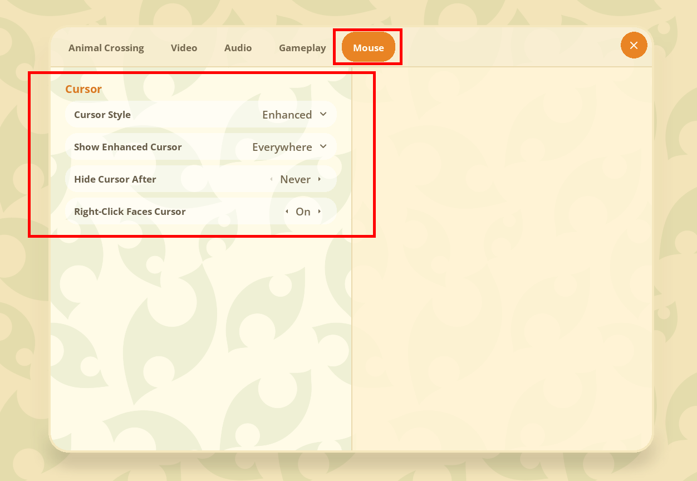
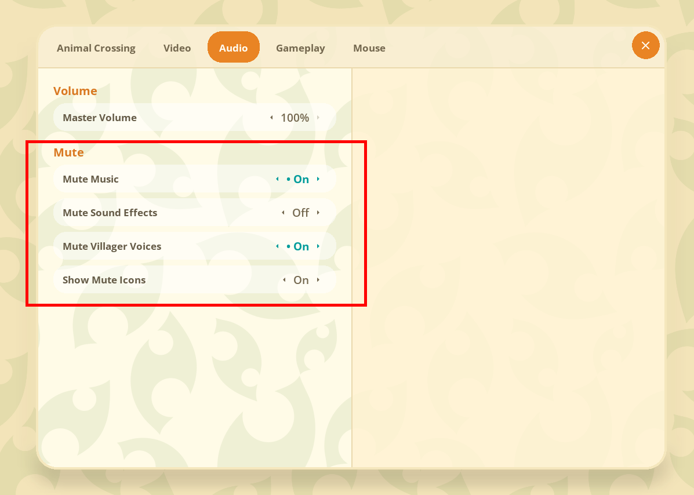
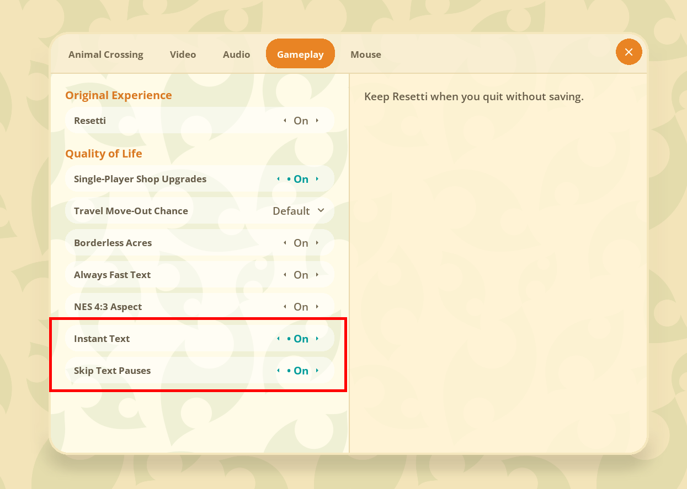

# Nookery Mods

**Four optional quality-of-life mods for Nookery, the Animal Crossing (GameCube) PC port.**

 

 

You choose which mods to install, and every option can be changed from the game's menus. Mods you don't install change nothing.

## The mods

| Mod | What it does | Where its settings are |
|---|---|---|
| Mouse Enhancements | An Enhanced cursor: the back of a smaller glove pointing to the top left, clicking on its fingertip and tilting into the world when you click. Use it out of menus, in menus (replacing the menu hand) or everywhere; keep the cursor from hiding when idle; right-click turns your character toward the cursor before interacting. Also fixes the glove blinking while you walk, and Print Screen or modifier keys hiding it. | Settings, Mouse (a tab that appears when this mod is on) |
| Audio Mutes | Separate mutes for music, sound effects and villager voices, each with a hotkey, and small icons in the lower left while muted. | Settings, Audio, Mute; hotkeys under Controls, Keyboard, Hotkeys |
| Instant Text | Text boxes appear all at once while the villager keeps speaking at the normal pace, cut off when you move on. Optional: skip every timed pause. | Settings, Gameplay |
| Save and Quit | A hotkey that opens the gyroid's save screen while you're outdoors in your own town. | Controls, Keyboard, Hotkeys |

## Screenshots

Mouse Enhancements adds a Mouse tab to Settings:

Audio Mutes adds a Mute section to Settings, Audio:

Instant Text adds two options to Settings, Gameplay:

## Download and install (Windows)

The release zip contains an installer that patches your existing Nookery folder in place and lets you pick which mods to switch on. It needs Python 3.9 or newer (from python.org or the Microsoft Store).

1. Download the zip from the Releases page and extract it anywhere, for example into your Nookery folder.
2. Close Nookery.
3. Double-click Install Nookery Mods.bat.
4. Choose your Nookery folder (the one with Nookery.exe), tick the mods you want, and press Install.
5. In Nookery's Settings, turn off the update check, or the updater will replace the modded build with the official one.

What the installer does:

- It checks your Nookery.exe is the version these mods were built for, Nookery commit 79f870a (2 November 2026). With any other version it stops and changes nothing.
- Before replacing anything it copies each file into a nookery-mods-backup folder inside your Nookery folder and checks the copy. The untouched official files are kept in nookery-mods-backup\original.
- It installs a Nookery.exe that contains every mod, the mods' text and style files, and a mods.json listing the mods you ticked. Mods you didn't tick stay switched off and add nothing to the game.

Run it again to change which mods are on, or press Uninstall to restore the official files. To update, run the installer from a newer release: it recognises earlier versions of these mods and replaces them, keeping your selection ticked. Your saves and config.json are never touched; mod settings in config.json are simply ignored by plain Nookery.

The installer also works from a command prompt: install_mods.py --list shows the mod ids, and install_mods.py --game FOLDER --mods mouse_enhancements,instant_text installs a selection without the window.

## Settings

Every option has a control in the game's menus (see the table above). They are saved in config.json in your Nookery data folder, under these keys.

| Key | Default | Menu name | Choices |
|---|---|---|---|
| input.cursorStyle | 1 (Enhanced) | Cursor Style | 0 Vanilla, 1 Enhanced |
| input.cursorScope | 2 (Everywhere) | Show Enhanced Cursor | 0 Out of Menus, 1 In Menus, 2 Everywhere |
| input.cursorHideSeconds | 0 (Never) | Hide Cursor After | 0 never hides the cursor, or 1 to 99 seconds without mouse movement (the original game uses 5) |
| input.rightClickFaceCursor | true | Right-Click Faces Cursor | Turn toward the cursor before a right-click interacts |
| audio.muteMusic, audio.muteSfx, audio.muteVoice | false | Mute Music, Mute Sound Effects, Mute Villager Voices | The three mutes |
| audio.muteMusicKey, audio.muteSfxKey, audio.muteVoiceKey | M, N, V | Hotkeys | Keys that toggle the mutes, by key name |
| audio.showMuteIcons | true | Show Mute Icons | Show the lower-left icons while something is muted |
| gameplay.instantText | false | Instant Text | Text boxes appear at once |
| gameplay.skipTextPauses | false | Skip Text Pauses | Skip every timed pause, including before self-clearing pages |
| input.saveQuitKey | F5 | Hotkeys, Save and Quit | Save and Quit key |

Hotkeys also reach the game, so a hotkey on a key bound to a game button does both. The default hotkeys are all keys Nookery's default keyboard layout leaves unbound; if you rebind your controls, keep them clear of these.

## For modders: build your own combination

The patches folder holds the source changes against Nookery commit 79f870a:

- 0000-mod-framework.patch: a small framework the mods share
- 0001-mod-mouse-enhancements.patch
- 0002-mod-audio-mutes.patch
- 0003-mod-instant-text.patch
- 0004-mod-save-quit.patch

Each mod keeps its code, strings (pc/res/lang/mods) and styles (pc/res/rml/mods) in its own files and registers itself through pc/include/acgc/mods.hpp, so any combination applies without conflicts.

1. Clone flyngmt/ACGC-PC-Port with its submodules and check out commit 79f870a.
2. Apply the framework first: git apply patches/0000-mod-framework.patch
3. Apply any of the mod patches you want, in any order.
4. Build as described in Nookery's BUILDING.md.

A build made this way switches on every mod it contains. To switch some off without rebuilding, put a mods.json next to Nookery.exe listing the ones to keep, in the form {"enabled": ["mouse_enhancements", "instant_text"]}.

To write your own mod, add a file under pc/src/mods that calls ACGC_REGISTER_MOD; the comments in pc/include/acgc/mods.hpp describe the hooks for settings, menu options, hotkeys and overlays.

## Credits and licence

Nookery is by FlyingMeta and contributors, built on the ac-decomp decompilation by ACreTeam. These mods are MIT-licensed (see LICENSE); Nookery's own licence notice is in THIRD_PARTY_NOTICES.md and must go with any build you share. No game files are included: Nookery loads them from your own disc image.
